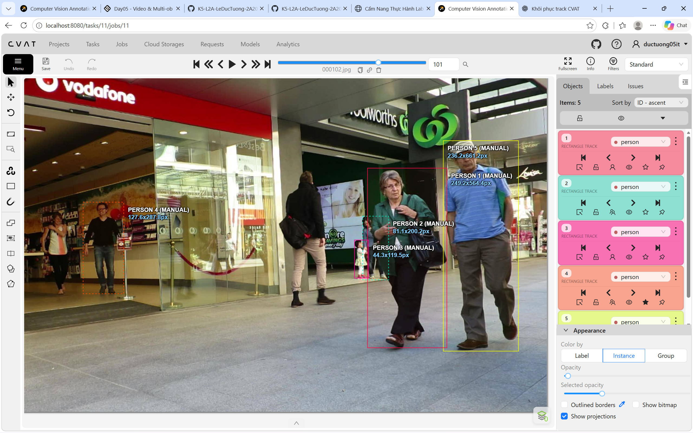
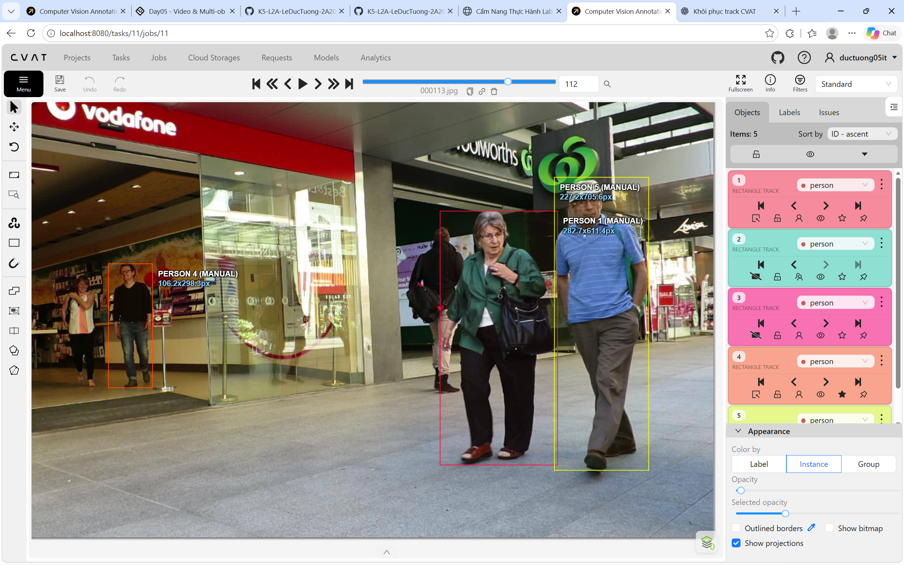
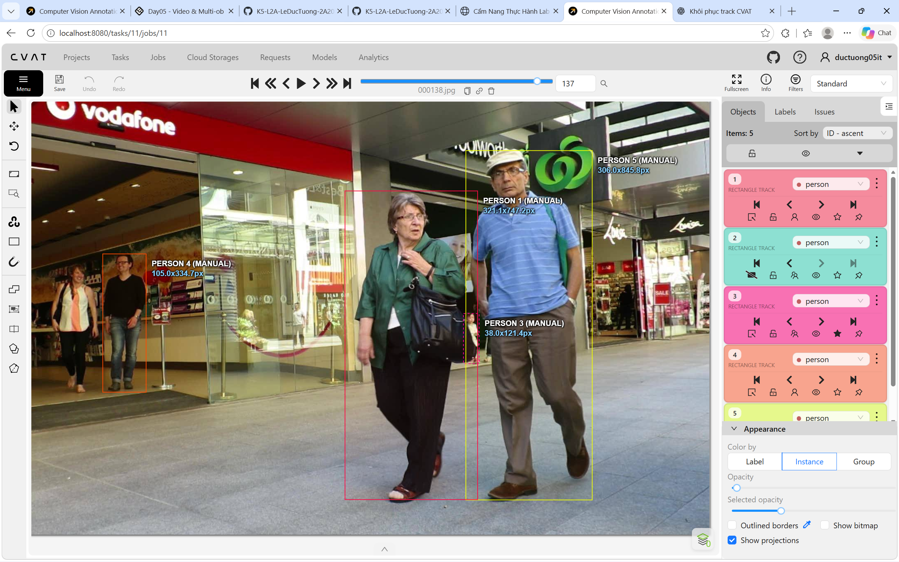

# Báo cáo cá nhân — LeDucTuong-2A202603066

## 0. Thông tin học viên

- Họ tên: Lê Đức Tường
- MSSV: 2A202603066
- Mã đề (A/B/C): B
- Email: 26ai.tuongld@vinuni.edu.vn
- Link repository: https://github.com/ductuong05it/K5-L2A-LeDucTuong-2A202603066-MOTTracking.git
- Giờ bắt đầu: 16h00
- Giờ kết thúc: 19h30

## 1. Xem trước đoạn video (CP0)

| Mã | Frame xuất hiện | Frame cuối thấy được | Rẽ / dừng / đổi tốc độ ở frame | Bị che ở frame | Ghi chú |
|---|---|---|---|---|---|
| P1 | 1 | 150| 1-10 | 36-57 | - |
| P2 | 1| 150 | - | - | - |
| P3 | 1 | 150| - | 1-65 | - |
| P4 | 1 | 147 | 1-150 |111-135 |-  |
| P5 | 1| 106 | 1-150 | -| - |

## 2. Keyframe và thời gian (CP1, CP4)

| Mã | Số keyframe | Keyframe ở frame | Số frame có mặt | Keyframe / 100 frame | Thời gian (phút) | Chỗ khó |
|---|---:|---|---:|---:|---|---|
| P1 (Track 0, tạm ghép) | 16 | 0, 10, 20, 29, 39, 49, 59, 69, 79, 89, 99, 109, 119, 129, 139, 149 | 150 | 10.7 | Chưa tách riêng | Theo dõi xuyên suốt video |
| P2 (Track 1, tạm ghép) | 8 | 0, 10, 20, 30, 40, 50, 88, 89 | 105 | 7.6 | Chưa tách riêng | Đối tượng chỉ xuất hiện trong một phần video |
| P3 (Track 2, tạm ghép) | 15 | 0, 10, 20, 30, 40, 50, 100, 105, 106, 110, 135, 137, 140, 141, 142 | 123 | 12.2 | Chưa tách riêng | Có khoảng gián đoạn và cần theo dõi khi xuất hiện lại |
| P4 (Track 3, tạm ghép) | 25 | 0, 20, 30, 45, 50, 51, 52, 53, 54, 55, 57, 71, 81, 91, 97, 98, 99, 100, 101, 112, 113, 123, 133, 143, 149 | 146 | 17.1 | Chưa tách riêng | Nhiều thay đổi cần điều chỉnh bounding box |
| P5 (Track 4, tạm ghép) | 18 | 0, 1, 11, 21, 31, 41, 51, 61, 64, 71, 80, 90, 100, 110, 120, 130, 140, 149 | 150 | 12.0 | Chưa tách riêng | Có nhiều frame bị che khuất |
| **Tổng** | **82** | — | **674** | **12.2** | **210 phút (toàn phiên)** | — |

Keyframe / 100 frame của cả bài = tổng keyframe ÷ tổng số frame có mặt × 100 = 82 ÷ 674 × 100 = **12.17 ≈ 12.2**.

Bạn đặt keyframe nhiều nhất ở người nào? Vì sao?

Track 3 có số keyframe nhiều nhất với 25 keyframe, tương ứng 17.1 keyframe trên 100 frame có mặt. Điều này cho thấy đối tượng cần được điều chỉnh bounding box thường xuyên hơn so với các track còn lại. Việc đặt nhiều keyframe giúp bám sát vị trí và kích thước đối tượng khi có sự thay đổi trong quá trình di chuyển.

## 3. Đoạn bị che (CP2)

Người bị che: P4

| Mốc | Frame |
|---|---:|
| Bắt đầu bị che một phần (bật `occluded`) | 106 |
| Mất hẳn (bật `outside`) | 112 |
| Hiện lại (tắt `outside`) | 136|
| Thấy rõ trở lại (tắt `occluded`) | 146 |

Thời gian khuất hẳn: 24=24/30 giây
Quyết định:  tạo track mới sau đó gộp lại thành chung 1 ID bằng Merge
Lý do (trả lời 3 câu: khuất bao lâu so với 60 frame, ngoại hình có khớp, chỗ hiện lại có đúng hướng và tốc độ):
khuất không lâu hơn 60 frame, có khớp ngoại hình, có đúng hướng tại chỗ do P4 không di chuyển nhiều
Ảnh chụp màn hình:







## 4. Tự review ID (CP3)

| Frame | Mã người | Loại lỗi | Mô tả một câu | Phát hiện ở lượt | Đã sửa? |
|---:|---|---|---|---|---|
| ok | — | — | - | — | — |
| ok | — | — | - | — | — |
| ok| — | — | - | — | — |

Tổng hợp số lỗi theo loại:

| `id_switch` | `fragmentation` | `lost` | `merge` | `false_track` | `drift` | `flag` |
|---:|---:|---:|---:|---:|---:|---:|
| 0 | 0 | 0 | 0 | 0 | 0 | 0 |

Lỗi nào chỉ lượt 2 (theo cảnh) mới thấy, lượt 1 (theo người) không thấy? Vì sao?

Đạt ngay lần đầu, 0 lỗi, 0 cảnh báo

## 5. File xuất và kết quả tự kiểm (CP4)

| Kiểm tra | Kết quả |
|---|---|
| Tên file MOT 1.1 | `src/exports/LeDucTuong_mot.zip` |
| Tên file CVAT for video 1.1 | `src/exports/LeDucTuong_cvat_video.zip` |
| Số track ID khác nhau trong `gt/gt.txt` (phải là 5) | 5 |
| Frame `outside` không có dòng trong `gt.txt` (đúng / sai) | Đã ghi nhận khoảng Outside trong kết quả kiểm tra; cần đối chiếu trực tiếp file để xác nhận riêng điều kiện này |
| Job đã completed trên CVAT máy cá nhân | Chưa xác nhận |

Dán phần tóm tắt in ra từ `src/check_submission.py`:

```text
MOT 1.1 LeDucTuong_mot.zip
5 track IDs | 674 boxes

Track 1: frames 0–149, 150 frames, no outside
Track 2: frames 0–104, 105 frames, no outside
Track 3: frames 0–146, 123 frames, outside 111–134
Track 4: frames 0–149, 146 frames, outside 41–44
Track 5: frames 0–149, 150 frames, no outside

CVAT for video 1.1:

Track 0 | person | 150 visible frames | 16 keyframes
10.7 KF/100 | 0 occluded frames | 0 outside activations
keyframes [0,10,20,29,39,49,59,69,79,89,99,109,119,129,139,149]

Track 1 | person | 105 visible frames | 8 keyframes
7.6 KF/100 | 16 occluded | 1 outside
keyframes [0,10,20,30,40,50,88,89]

Track 2 | person | 123 visible frames | 15 keyframes
12.2 KF/100 | 17 occluded | 2 outside
keyframes [0,10,20,30,40,50,100,105,106,110,135,137,140,141,142]

Track 3 | person | 146 visible frames | 25 keyframes
17.1 KF/100 | 65 occluded | 1 outside
keyframes [0,20,30,45,50,51,52,53,54,55,57,71,81,91,97,98,99,100,101,112,113,123,133,143,149]

Track 4 | person | 150 visible frames | 18 keyframes
12.0 KF/100 | 64 occluded | 0 outside
keyframes [0,1,11,21,31,41,51,61,64,71,80,90,100,110,120,130,140,149]

Total 82 keyframes / 674 visible frames = 12.2 keyframes per 100 frames.

Summary: 0 errors, 0 warnings. Passed.
```

## 6. Ba câu kết

1. Nếu được gán lại, bạn sẽ đặt keyframe khác ở đâu? Vì sao?

Nếu được thực hiện lại, em sẽ cân nhắc đặt thêm keyframe tại những đoạn đối tượng thay đổi hướng di chuyển, thay đổi tốc độ hoặc bị che khuất. Đặc biệt, những đoạn có nhiều người di chuyển gần nhau cần được kiểm tra kỹ hơn để tránh bounding box bị lệch khi nội suy.

2. Có chỗ nào bạn không chắc "cùng ID hay ID mới"? Bạn đã quyết định và ghi chú thế nào?

Trong quá trình tracking, trường hợp khó quyết định nhất là khi đối tượng bị che khuất rồi xuất hiện lại. Em ưu tiên giữ nguyên ID nếu đặc điểm ngoại hình, hướng di chuyển và vị trí xuất hiện phù hợp với đối tượng ban đầu. Nếu không đủ cơ sở xác định thì cần kiểm tra lại các frame lân cận thay vì tùy tiện tạo ID mới.

3. Một lỗi ID trong job của bạn (nếu không còn sót, chọn lỗi đã sửa) có thể làm xe tự lái dự đoán sai chuyển động của người đó như thế nào? Lỗi đó ảnh hưởng MOTA hay IDF1 nhiều hơn?

Nếu một người bị gán nhầm sang ID của người khác, hệ thống có thể hiểu nhầm hai người là cùng một đối tượng hoặc một người thành hai đối tượng khác nhau. Điều này làm gián đoạn lịch sử chuyển động, khiến hệ thống dự đoán sai hướng và quỹ đạo di chuyển của người đi bộ. Lỗi ID switch thường ảnh hưởng rõ hơn đến IDF1 vì chỉ số này đánh giá khả năng duy trì danh tính đối tượng qua các frame. MOTA cũng bị ảnh hưởng do tính đến số lượng lỗi liên quan đến ID switch, nhưng còn phụ thuộc vào cả false positive và false negative.

## Bonus (nếu làm)

## 7. Tài liệu tham khảo và công cụ AI đã dùng

- CVAT Documentation: https://docs.cvat.ai/
- MOTChallenge: https://motchallenge.net/
- Repository và tài liệu hướng dẫn của bài thực hành: https://github.com/ductuong05it/K5-L2A-LeDucTuong-2A202603066-MOTTracking
- `src/check_submission.py`: kiểm tra cấu trúc và thống kê dữ liệu export.
- ChatGPT: hỗ trợ giải thích quy trình gán nhãn, tổng hợp kết quả kiểm tra và hỗ trợ trình bày báo cáo.